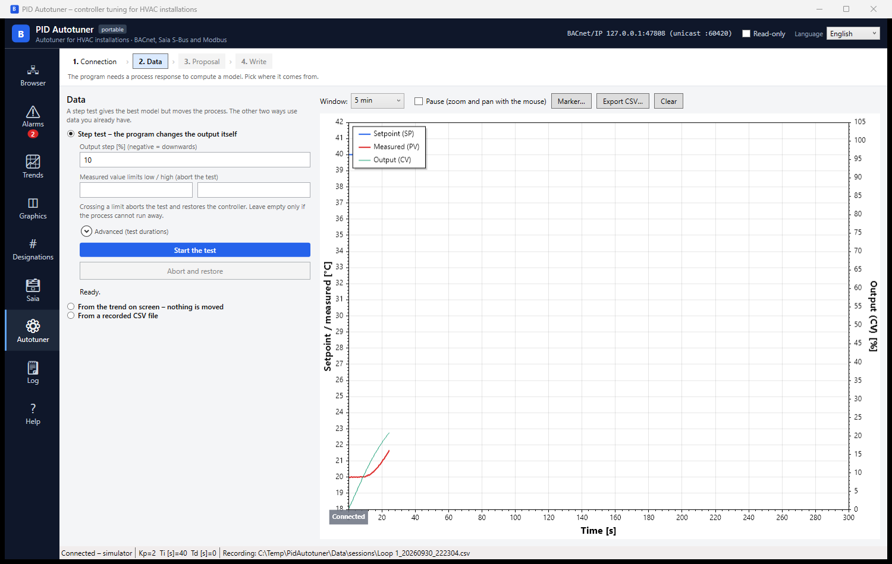

# PID Autotuner

Tunes controllers in HVAC installations. It measures how the plant responds, computes PID settings, and
writes them to the controller — over **BACnet/IP**, **Saia Ether-S-Bus** or **Modbus**.

A native Windows program (.NET 8). Nothing to install besides the program itself: the runtime is included.

> **This is a beta.** It is complete enough to use on real equipment, but it has not been through a season of
> daily work. Expect bugs, and **please report them** — see [Reporting a problem](#reporting-a-problem).

*Step 2 of four: the program is connected and recording the loop; from here a step test, a trend range or a
CSV file gives it the plant response it needs.*

## Download

The latest [release](../../releases) has, for Windows x64:

| File | For |
|---|---|
| `PidAutotuner-<version>-x64.msi` | install for all users: Start menu shortcut, firewall rule for UDP 47808 |
| `PidAutotuner-<version>-x64-portable.zip` | unpack and run; all data stays in a `Data` folder beside the program |

The portable build writes nothing to the user profile as long as `portable.txt` sits next to the executable,
so it runs from a memory stick. The packages are not digitally signed, so SmartScreen warns about an unknown
publisher.

Silent install: `msiexec /i PidAutotuner-<version>-x64.msi /qn`.

## What it does

**Tuning, in four steps.** The program moves on by itself as soon as it has what it needs.

1. **Connection** — protocol, the points of the loop, the controller's parameter form, a connection test.
2. **Data** — the plant response from a **step test** (the program moves the output itself and restores the
   controller afterwards), from the visible range of a **trend**, or from a **CSV file**.
3. **Proposal** — the plant model (FOPDT/IPDT with R² and NRMSE), present versus proposed side by side, a
   simulated comparison, and a choice of method: SIMC, Lambda or AMIGO, PI or PID, with a
   conservative ↔ aggressive slider.
4. **Write** — a backup of the previous settings, a read-back, automatic roll-back on a mismatch, "Restore
   previous", and an entry in `audit.log`.

**And the toolset around it**: a BACnet browser (discovery, object tree, properties, writing, COV watching,
schedules, calendars, EDE export, snapshots), alarms (event notifications, active alarms, registering as a
recipient), trends (historian and trend-log buffers), a simple graphics editor, ISO 81346 designation
analysis, a Saia memory explorer, and a diagnostic log.

### Point addresses

| Protocol | Syntax | Examples |
|---|---|---|
| BACnet | `TYPE:instance[/property]` | `AI:1`, `AV:3`, `AO:2`, `BV:4`, `LOOP:1/proportional-constant` |
| Saia | `R<no>[:IEEE\|FFP\|INT][*scale]`, `F<no>` | `R100`, `R100:FFP`, `R205:INT*0.1`, `F12` |
| Modbus | `<table>:<address>[:<type>][/<order>][*<scale>][@<slave>]` | `hr:100:F32`, `hr:40:I16*0.1`, `co:12`, `ir:7:U32/CDAB`, `hr:7:F32@3` |

For Modbus the **table has to be named** (`hr` holding, `ir` input, `co` coil, `di` discrete input). Modbus
gives no way of telling a holding register from an input register by the address alone, and reading the wrong
table either fails or — worse — returns a plausible number from somewhere else entirely.

## Writing to a controller

These properties hold everywhere in the program and cannot be switched off:

- every write is confirmed first, in a dialog naming what is changing and in which controller;
- after writing, the value is read back; on a mismatch a PID write is rolled back automatically;
- every write is recorded in `audit.log` with time, user, controller, address and value;
- the step test restores the controller's previous mode and output on completion, on abort and on error;
- **read-only mode** refuses every write at the transport, so nothing can leave the program by any route;
- read-only data stays read-only: BACnet digital inputs, Saia inputs, Modbus input registers and discrete
  inputs.

The program cannot stop the controller's own program from overwriting a value afterwards, and the
confirmation dialog says so.

**Before you run it against a real plant.** A step test moves a real process. Run it only where the plant can
safely operate without control for the duration of the test, and set the safety limits on the measured value
before you start. In a beta this matters more, not less.

## Using it

Press **F1** anywhere for the built-in manual; it is generated from the program's own module list, so it
describes exactly what this build has. The interface is **Polish, English or German**, switched in the title
bar and applied at once.

The quantities are spelled out — setpoint, measured value, controller output — with SP / PV / CV only in
brackets.

## Known limits

- The Saia explorer has been tested against a simulated PCD and the two PG5 symbol formats, not yet against a
  live controller.
- Saia timers, counters, DB blocks and texts cannot be read: those S-Bus command codes have to be confirmed
  in the documentation rather than guessed, so they were left out.
- Modbus points are typed by hand — there is no point picker for Modbus as there is for BACnet and Saia.
- The graphics module is kept but no longer developed, and has no background image.

## Reporting a problem

Send what you did, what happened, what you expected — and the log file, which says more than anything else.
The status bar message has a **Copy** button, and the Log module has **Open the log folder**; the current
day's file from there is the one to attach.

[Open an issue](../../issues) or write to **kontakt@ihvac.pl**.

## Licence

MIT. The source lives in a private repository; the released programs bundle only MIT-licensed libraries.

There is no warranty of any kind. The software writes to building automation controllers; the installation
you connect it to stays your responsibility.
